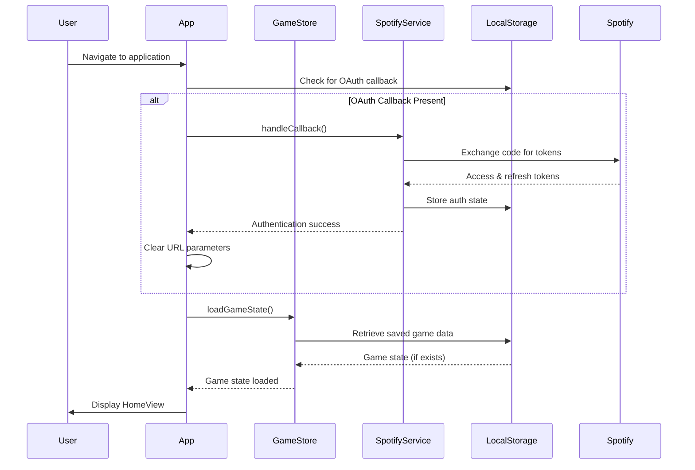
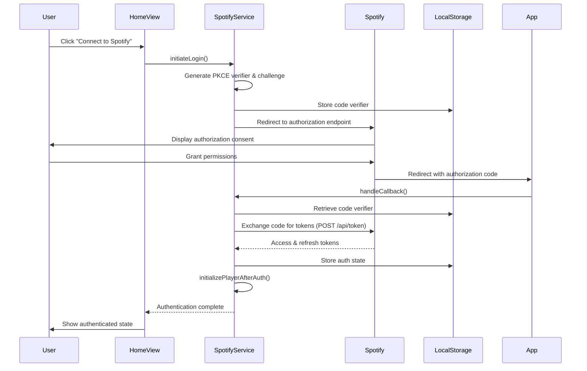
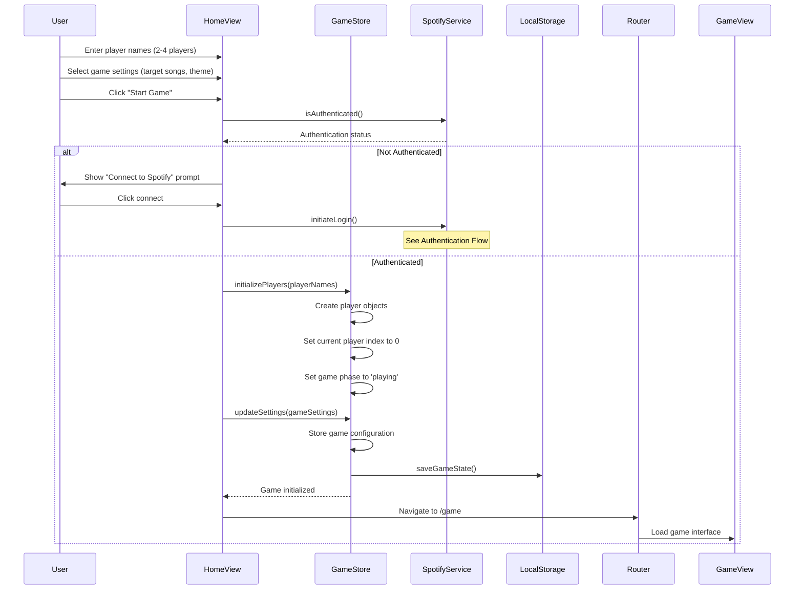
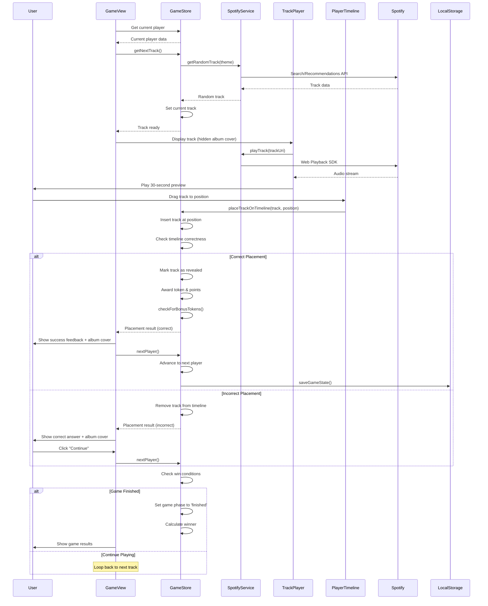
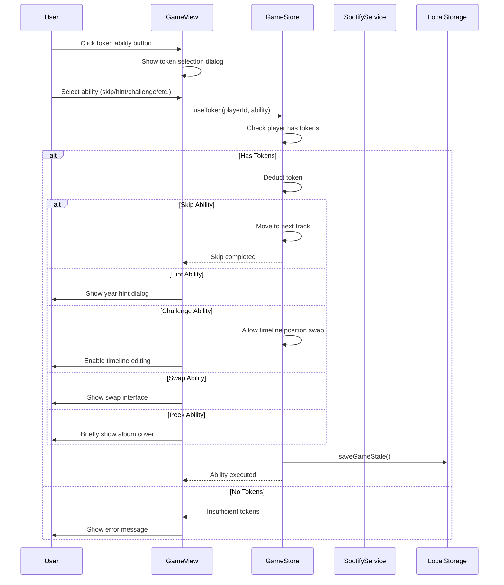
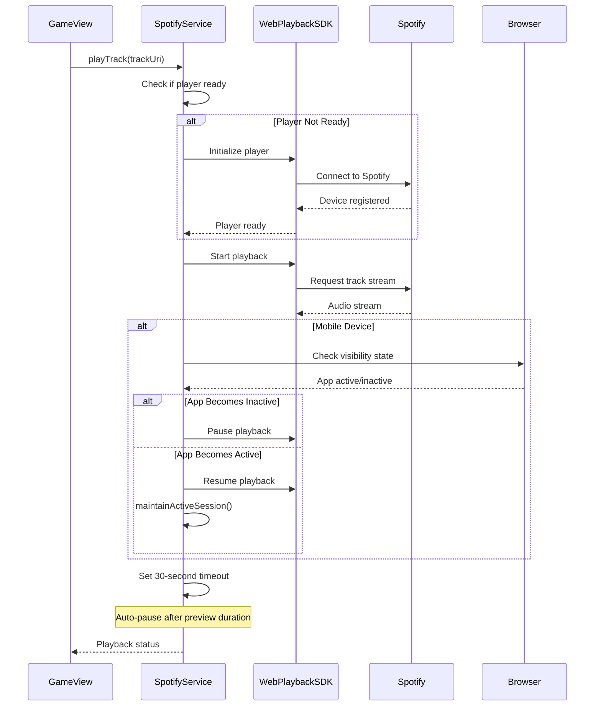
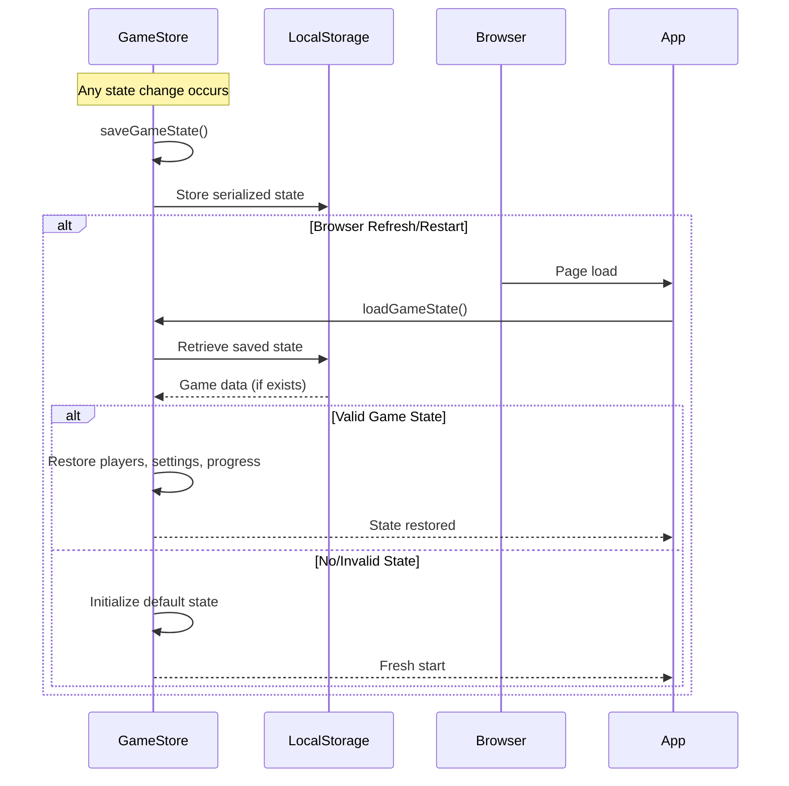
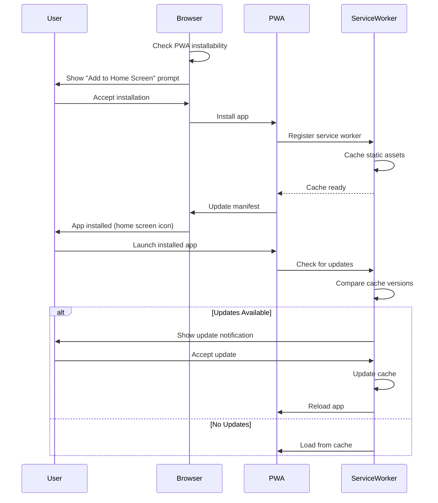
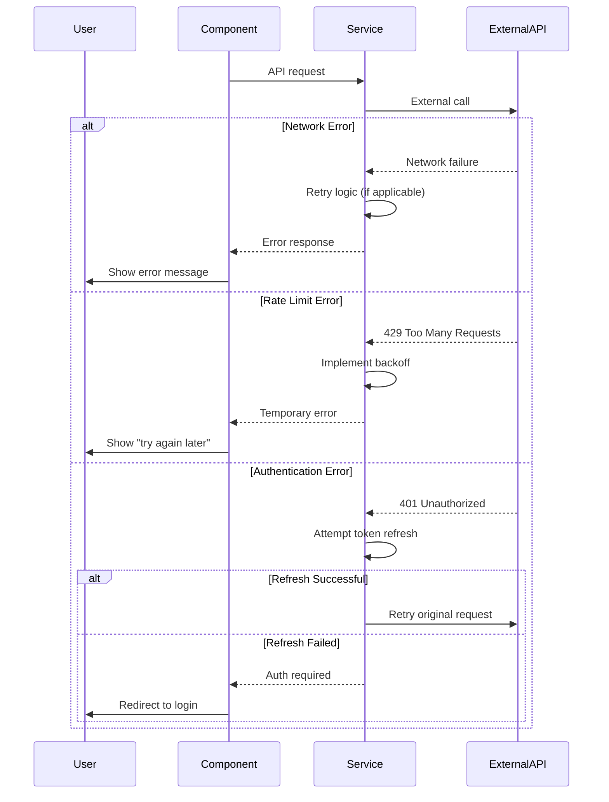

# Sequence Diagrams

This document contains sequence diagrams for the key user flows and system interactions in the Hipster application.

## 1. Application Startup Flow

## 2. Spotify Authentication Flow

## 3. Game Setup Flow

## 4. Main Gameplay Flow

## 5. Token Ability Usage Flow

## 6. Web Playback SDK Management Flow

## 7. Game State Persistence Flow

## 8. Progressive Web App Installation Flow

## 9. Error Handling Flow

## Notes on Sequence Diagrams

### Diagram Conventions
- **Participants**: Represent the main actors/components in each flow
- **Arrows**: Solid arrows for calls, dashed arrows for responses
- **Alt/Else**: Alternative flows based on conditions
- **Notes**: Additional context or explanations

### Implementation Details
- All sequences use async/await patterns for API calls
- Error handling is implemented at each service boundary
- State changes trigger automatic persistence to localStorage
- Mobile-specific optimizations are included where relevant

### Future Enhancements
- Real-time multiplayer sequences (WebSocket integration)
- Backend API integration sequences
- Advanced analytics and tracking sequences